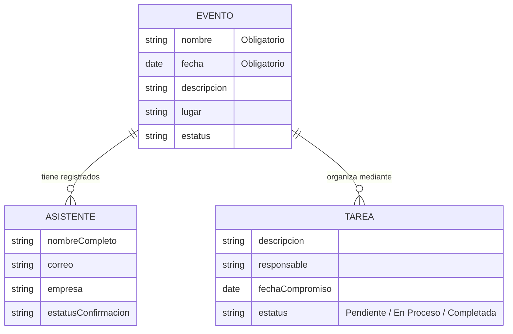

# Facilitación Ágil y Técnica: Caso de Gestión de Eventos Corporativos (GCS)

Esta habilidad proporciona directrices para orientar a los equipos en la construcción de su prototipo en **Siemens Mendix** y la preparación del **Documento PDF** y **Video de 3 minutos**.

---

## 1. Alcance Funcional Mínimo del Prototipo en Mendix

El prototipo debe cubrir tres entidades interconectadas:

### Funcionalidades Demostrables en Video (Máx 3 Minutos):
1. **Creación y consulta de evento** (A1) y **edición verificable** (A2).
2. **Registro de asistente** vinculado al evento (A3).
3. **Creación de tarea** con responsable y fecha (A4), y **actualización de estatus** (A5).
4. **Envío de aviso o recordatorio** con destinatario visible (A6).
5. **Vista en calendario** o listado ordenado por fecha (A7).
6. **Flujo integrado sin interrupciones** (A8).
7. **Navegación contextual y mensajes de validación** (B1, B2, B3).

---

## 2. Elaboración del Documento Técnico (PDF)

El PDF debe estructurarse conforme a los indicadores evaluados en documento:
1. **Modelo de Dominio Mendix / ERD (C1):** Captura de pantalla legible de Mendix Studio Pro mostrando `Evento`, `Asistente` y `Tarea` con asociaciones correctas.
2. **Implementación de Microflujo (C2):** Diagrama de un microflujo (ej: validación de cupo, notificación o cambio de estado de tarea) explicando parámetros, decisiones y salida.
3. **Prueba de Persistencia (C3):** Evidencia paso a paso de guardado, recarga de la aplicación y comprobación de integridad del dato.
4. **Product Backlog Ágil (D1, D2):**
   - Historias de usuario redactadas en formato: *Como organizador de eventos, quiero registrar asistentes asociados a una fecha para controlar el aforo.*
   - Criterios de aceptación Gherkin: *Dado que el aforo es menor a 100, cuando registro un asistente, entonces se incrementa el contador y se envía confirmación.*
   - Estimación en Story Points y priorización MoSCoW justificada.
5. **Trazabilidad de Sprints (D3):** Tabla de historias planificadas vs. entregadas en cada sprint, con un ejemplo documentado de adaptación o replanificación ágil.
6. **Bitácora de Pruebas y Seguridad (E1, E2, E3):**
   - Matrices de prueba de Eventos, Asistentes y Tareas.
   - Caso documentado de error detectado y remediado.
   - Prueba con usuario final y validación de seguridad de entradas.

